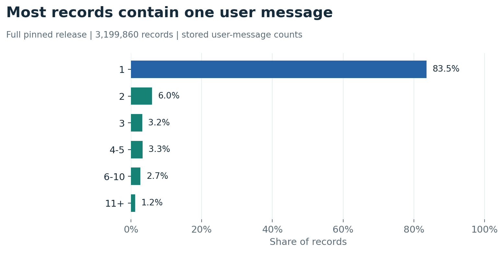
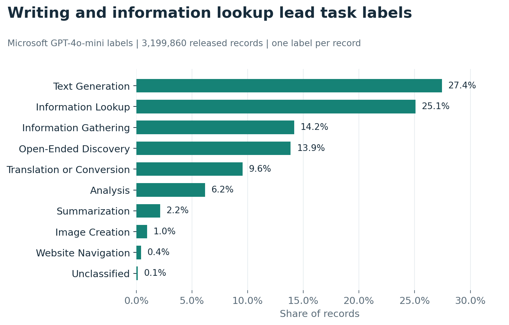
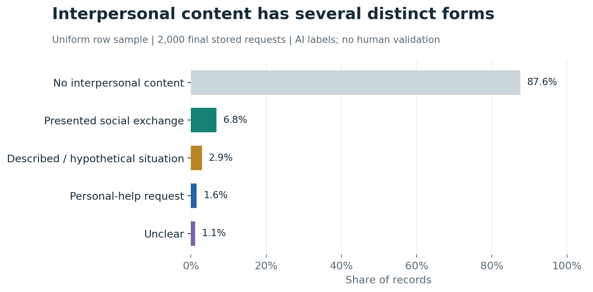

# WildChat EDA

An independent exploratory analysis of **3,199,860 conversation records** in a pinned, publisher-filtered WildChat release. This repository contains the analysis code, saved results, **24 figures**, and the source for the public data browser.

**[Interactive hub ↗](https://wildchat-research-atlas-jenny.landenini.chatgpt.site)** · **[PDF figure book](website/assets/WildChat_Relational_EDA.pdf)** · **[All figures](docs/FIGURES.md)** · **[Dataset comparison](docs/DATASETS.md)**

## What the data shows

| Finding | What it means | Evidence |
| --- | --- | --- |
| **Stored exchanges are usually short.** | 83.5% of records contain one user message. A message may still contain pasted conversation history. | Counted across all 3,199,860 records. |
| **Writing and information lookup are common.** | 52.5% of records receive either the text-generation or information-lookup task label. Topic and task measure different things. | Released AI labels, aligned to the full pinned export. |
| **Interpersonal content takes several forms.** | AI labeled 225 of 2,000 sampled final requests as interpersonal; 31 of those were personal help. Supplied dialogue and hypothetical material are separate categories. | Uniform record sample; **no human validation**. |
| **Repeated formats shape the corpus.** | One literal group-bot template occurs in 6.4% of records. That wording does not establish a real group interaction. | A documented text rule applied to the full export. |
| **Cross-conversation linkage is tentative.** | Exact IP/browser combinations recur, usually over short spans. These combinations are **not verified people**. | Aggregate metadata analysis; identifiers are not published. |

These findings describe this released corpus. They do not estimate all AI use or establish changes in users' lives.

### Conversation depth



### Task labels



### Interpersonal content



## Start here

| To understand… | Read / open |
| --- | --- |
| What one record contains | [Methods and units](docs/METHODS.md#units) · [Original question/response examples ↗](https://wildchat-research-atlas-jenny.landenini.chatgpt.site/atlas.html#cases) |
| Languages, models, dates, lengths and turns | [Interactive distributions ↗](https://wildchat-research-atlas-jenny.landenini.chatgpt.site/#distributions) · [Figure catalog](docs/FIGURES.md) |
| Topic versus task | [Select a label and read its original exchange ↗](https://wildchat-research-atlas-jenny.landenini.chatgpt.site/#distributions?chart=domain) · [Label provenance](docs/METHODS.md#topic-and-task) |
| Sampling differences and AI-label limits | [Overlay a sample with the full release ↗](https://wildchat-research-atlas-jenny.landenini.chatgpt.site/#distributions?chart=language&scope=original&compare=1) · [Data scopes](docs/METHODS.md#analysis-scopes) |
| What can be linked across conversations | [Linkage analysis](docs/METHODS.md#cross-conversation-association) · [Interactive charts ↗](https://wildchat-research-atlas-jenny.landenini.chatgpt.site/#linkage) |
| Similar public conversation datasets | [WildChat, LMSYS, OpenAssistant, PRISM and UltraChat](docs/DATASETS.md) |
| How to run the website or rebuild charts | [Reproduction instructions](docs/REPRODUCE.md) |

## Keep the scopes separate

| Analysis | Denominator | Selection / source |
| --- | ---: | --- |
| Metadata census | **3,199,860 records** | All 86 files in one pinned, filtered export. |
| Topic and task | **3,199,860 records** | Microsoft's released AI labels; unclassified rows remain in the denominator. |
| Original metadata sample | **20,000 records** | 200 seeded blocks of 100 consecutive rows. |
| Row-random reference | **20,000 records** | Separate uniform draw without replacement. |
| Final-request content | **2,000 records** | Uniform draw without replacement; AI labels using stored context. |
| Historical content pilot | **120 final requests** | Earlier AI-label analysis, retained as an archive. |
| Displayed examples | **Selected records** | Illustrations, not a random sample. |

Source: [`allenai/WildChat-4.8M`](https://huggingface.co/datasets/allenai/WildChat-4.8M/tree/c827c6df8fcf008219ffaffa4d1dd77491099367), revision `c827c6df8fcf008219ffaffa4d1dd77491099367`, `default/train`, record dates **9 April 2023–31 July 2025**. The release name “4.8M” is not the denominator of this filtered export.

Topic/task source: [`microsoft/adopt-adapt-wildchat`](https://github.com/microsoft/adopt-adapt-wildchat/tree/b4e77e44b62ba2ddd0f7b53667b218e345faba09), revision `b4e77e44b62ba2ddd0f7b53667b218e345faba09`.

## Run locally

The website needs only Python's static server:

```sh
git clone https://github.com/hanzhenzhujene/wildchat-eda.git
cd wildchat-eda
python3 -m http.server 8765 --directory website
```

Open `http://localhost:8765/`. No account, model API key or build step is required.

For analysis, install the Python dependencies, then validate the saved release:

```sh
python3 -m venv .venv
source .venv/bin/activate
pip install -r requirements-lock.txt
make check
make test
```

Node.js 22+ runs the JavaScript checks. `make figures` rebuilds the current charts and PDF from saved aggregates, without downloading conversations or calling a model. Full source recomputation is separate; see [Reproduce](docs/REPRODUCE.md).

## Repository map

```text
analysis/
  src/       Statistical extraction, sampling and annotation code
  config/    Pinned source and AI-label protocol
  outputs/   Saved counts, checksums and sampling manifests
website/
  assets/    12 current PNG/SVG charts, 12 archive charts, PDF
  data/      Public exports, label status and provenance
  *.html/js/css   Hub and original interactive browser
scripts/     Figure builder and release checks
docs/        Methods, reproduction, figure index, dataset review
```

The site includes selected WildChat excerpts already shown in the public browser. Original text, marked redactions and AI paraphrases are distinguished. Bulk conversation caches, per-record linkage keys and device/header values are not included.

## Attribution

This is an independent analysis, not an official WildChat or Microsoft release. Cite [WildChat: 1M ChatGPT Interaction Logs in the Wild](https://arxiv.org/abs/2405.01470) when reusing the underlying data. The code license does not replace source-data terms; see [Data licenses and attribution](DATA_LICENSES.md).
